<!-- Shreyas Prajapati | Black Bulls Grimoire | GitHub profile README -->
<!-- Needs the assets/ folder (banner, magic-circle, divider, emblems) next to this file in your PresenceOP-Coder/PresenceOP-Coder repo -->

<!-- Tumblr header kept. Tip: download it to assets/header.gif and use src="assets/header.gif" so it never breaks -->

  
  
  

  
  
  

### 🍀 01 / GRIMOIRE CARD

<table align="center" width="100%" cellpadding="10">
<tr>
<td width="220" align="center" valign="middle">
   
  <b>FOUR-LEAF GRIMOIRE</b>
</td>
<td valign="middle">
  <b>Shreyas Prajapati</b> — CS undergrad at <b>IIIT Bhagalpur</b> (batch of 2028), building backend systems that survive contact with the real world.
    
  I like <b>Go</b>, <b>distributed systems</b> and clean interfaces on top of them. I ship at hackathons (SIH and beyond), build things nobody asked for, and try to contribute to open source.
    
  <code>SQUAD&nbsp;&nbsp;&nbsp;&nbsp;&nbsp;Black Bulls</code> 
  <code>ATTRIBUTE&nbsp;Go · Backend · Distributed Systems</code> 
  <code>GRIMOIRE&nbsp;&nbsp;[███████████████░░░░░] YEAR 3 / 4</code> 
  <code>OPEN TO&nbsp;&nbsp;&nbsp;Hackathons · Open source · Collabs</code>
</td>
</tr>
</table>

### ⚔️ 02 / MAGIC ATTRIBUTES

<table align="center" width="100%" cellpadding="12">
<tr>
<td align="center" width="50%" valign="top">
   
  <b>ASTA'S ANTI-MAGIC</b> 
  
   
  <i>Raw power that cuts through abstractions.</i>  
  
</td>
<td align="center" width="50%" valign="top">
   
  <b>YUNO'S WIND &amp; STAR MAGIC</b> 
  
   
  <i>Fast, scalable, elevated infrastructure.</i>  
  
  <code>Render</code>
</td>
</tr>
<tr>
<td align="center" valign="top">
   
  <b>NOELLE'S WATER MAGIC</b> 
  
   
  <i>Beautiful, adaptable, fluid interfaces.</i>  
  
</td>
<td align="center" valign="top">
   
  <b>YAMI'S DARK MAGIC</b> 
  
   
  <i>Heavy lifting and controlling the flow of data.</i>  
  
  <code>JWT</code>
</td>
</tr>
</table>

### 📖 03 / GRIMOIRE PAGES &nbsp;(featured quests)

<!-- Update the repo links below if your repo names differ -->
<table align="center" width="100%" cellpadding="12">
<tr>
<td width="90" align="center" valign="middle"></td>
<td valign="top" width="50%">
  <b><a href="https://github.com/PresenceOP-Coder/Kairos">KAIROS</a></b> 
  <code>Go</code> · <code>TCP</code> · <code>React</code> 
  Chaos-engineering TCP proxy with a scenario DSL, scheduler and triggers. React dashboard in progress.
</td>
<td width="90" align="center" valign="middle"></td>
<td valign="top" width="50%">
  <b><a href="https://github.com/PresenceOP-Coder/Looped">LOOPED</a></b> 
  <code>Flutter</code> · <code>Dart</code> 
  Habit tracker with a clean, focused interface, built for the Play Store.
</td>
</tr>
<tr>
<td align="center" valign="middle"></td>
<td valign="top">
  <b><a href="https://github.com/PresenceOP-Coder/Aether">AETHER</a></b> 
  <code>C++</code> · <code>OpenGL</code> 
  FOSS Hack project simulating real-world physics from scratch.
</td>
<td align="center" valign="middle"></td>
<td valign="top">
  <b>UNNATI WELFARE SOCIETY APP</b> 
  <code>In development</code> 
  An app built for the Unnati Welfare Society.
</td>
</tr>
</table>

### 📊 04 / COMBAT STATISTICS

  
  &nbsp;
  

  

<picture>
  <source media="(prefers-color-scheme: dark)" srcset="https://raw.githubusercontent.com/PresenceOP-Coder/PresenceOP-Coder/output/github-snake-dark.svg"/>
  <source media="(prefers-color-scheme: light)" srcset="https://raw.githubusercontent.com/PresenceOP-Coder/PresenceOP-Coder/output/github-snake.svg"/>
  
</picture>

### 🤝 05 / SUMMON ME

Open to collaboration, learning, and building impactful software.

  

  

Fan-made theme inspired by Black Clover. Character GIFs belong to their respective owners.

