<!-- Shreyas Prajapati | Legendary Pokédex, 1-bit hacker edition | GitHub profile README -->
<!-- Repo layout: README.md + assets/*.svg + .github/workflows/snake.yml (all included) -->

<!-- Tumblr header kept. Tip: download it to assets/header.gif and use src="assets/header.gif" so it never breaks -->

  
  
  

  
  
  
  
  


  

 

> **Shreyas Prajapati**: CS undergrad at **IIIT Bhagalpur** (batch of 2028), building backend systems that survive contact with the real world. I like **Go**, **distributed systems** and clean interfaces on top of them. I ship at hackathons (SIH and beyond), build things nobody asked for, and contribute to open source.

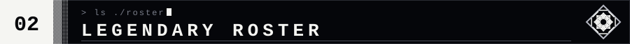

<table align="center" width="100%" cellpadding="12">
<tr>
<td align="center" width="33%" valign="top">
   
  <b>RAYQUAZA</b> 
   
  <i>Rules the sky layer: fast, scalable backend.</i>  
  
  
  
  
</td>
<td align="center" width="33%" valign="top">
   
  <b>DIALGA</b> 
   
  <i>Bends time: concurrency, schedulers, distributed systems.</i>  
  <code>Goroutines</code> · <code>TCP</code> · <code>Schedulers</code>
</td>
<td align="center" width="33%" valign="top">
   
  <b>PALKIA</b> 
   
  <i>Warps space: graphics and physics from scratch.</i>  
  
  
  
  
</td>
</tr>
<tr>
<td align="center" valign="top">
   
  <b>GIRATINA</b> 
   
  <i>Lives in the Distortion World: chaos engineering.</i>  
  <code>Fault Injection</code> · <code>Proxies</code> · <code>DSLs</code>
</td>
<td align="center" valign="top">
   
  <b>GROUDON</b> 
   
  <i>Raw power that carves through abstractions: data and storage.</i>  
  
  
  
  
</td>
<td align="center" valign="top">
   
  <b>KYOGRE</b> 
   
  <i>Fluid, beautiful interfaces that flow on every screen.</i>  
  
  
  
</td>
</tr>
<tr>
<td align="center" colspan="3" valign="top">
   
  <b>MEWTWO</b> &nbsp; 
  <i>Engineered for maximum power: the dev toolkit.</i>  
  
  
  
  
  
  
  
  
</td>
</tr>
</table>

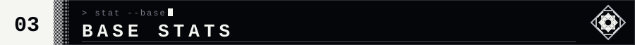

  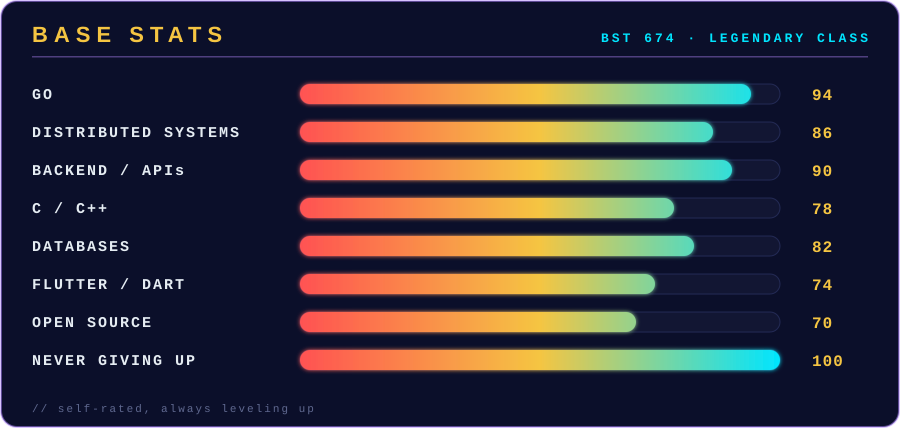


<table align="center" width="100%" cellpadding="12">
<tr>
<td width="200" align="center" valign="middle">
  
  
</td>
<td valign="top" width="50%">
  <b><a href="https://github.com/PresenceOP-Coder/Kairos">KAIROS // DISTORTION WORLD</a></b> 
  <code>Go</code> · <code>TCP</code> · <code>React</code> · <code>Chaos Engineering</code> 
  Chaos-engineering TCP proxy with a scenario DSL, scheduler and triggers. React dashboard in progress.
</td>
<td width="200" align="center" valign="middle">
  
  
</td>
<td valign="top" width="50%">
  <b><a href="https://github.com/PresenceOP-Coder/Looped">LOOPED // ENDLESS TIDE</a></b> 
  <code>Flutter</code> · <code>Dart</code> · <code>Play Store</code> 
  Habit tracker with a clean, focused interface, built for the Play Store.
</td>
</tr>
<tr>
<td align="center" valign="middle">
  
  
</td>
<td valign="top">
  <b><a href="https://github.com/PresenceOP-Coder/Aether">AETHER // SPATIAL RIFT</a></b> 
  <code>C++</code> · <code>OpenGL</code> · <code>Physics</code> 
  FOSS Hack project simulating real-world physics from scratch.
</td>
<td align="center" valign="middle">
  
  
</td>
<td valign="top">
  <b>UNNATI WELFARE SOCIETY APP // SKY PILLAR</b> 
  <code>In development</code> 
  An app built for the Unnati Welfare Society: software with real-world impact.
</td>
</tr>
</table>


  
  &nbsp;
  

  

  

<picture>
  <source media="(prefers-color-scheme: dark)" srcset="https://raw.githubusercontent.com/PresenceOP-Coder/PresenceOP-Coder/output/github-snake-dark.svg"/>
  <source media="(prefers-color-scheme: light)" srcset="https://raw.githubusercontent.com/PresenceOP-Coder/PresenceOP-Coder/output/github-snake.svg"/>
  
</picture>


Open to collaboration, learning, and building impactful software.

  

  

 


Fan-made profile visuals. Pokémon sprites courtesy of <a href="https://github.com/PokeAPI/sprites">PokeAPI/sprites</a>.

